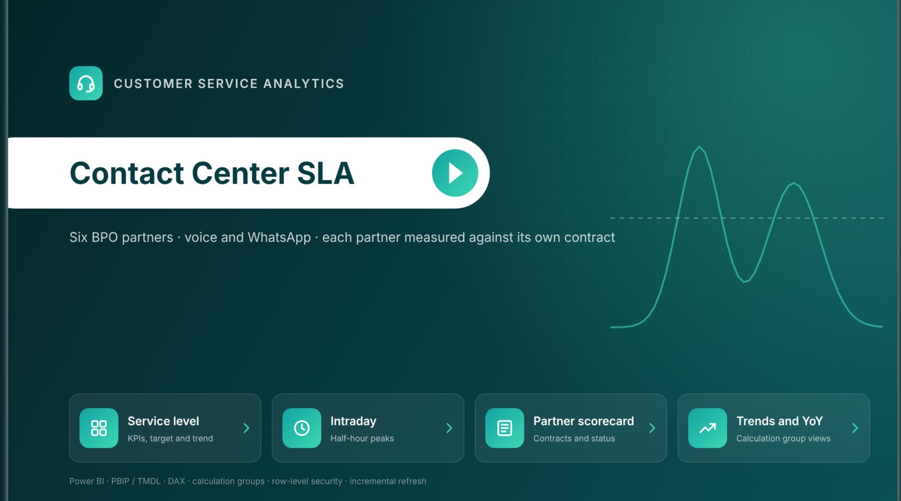
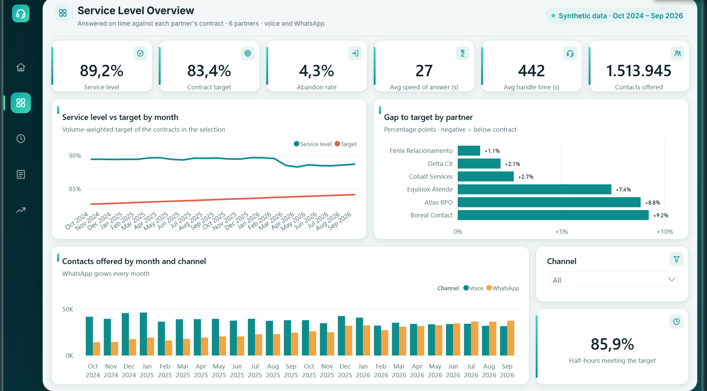
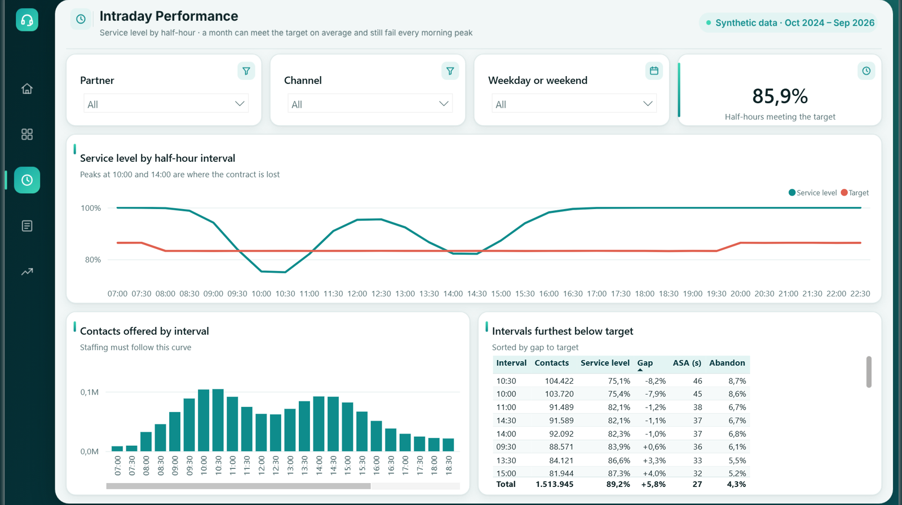
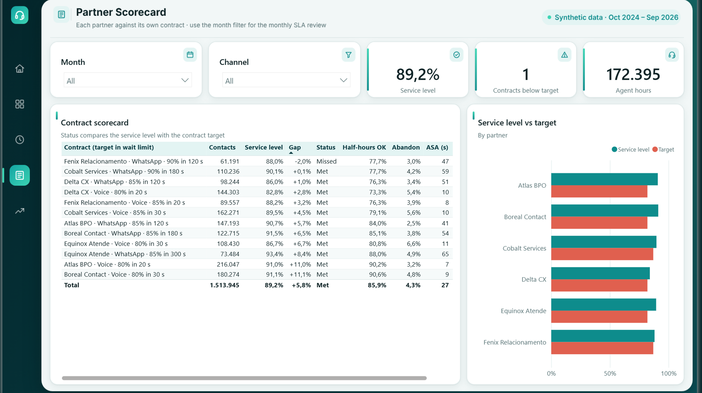
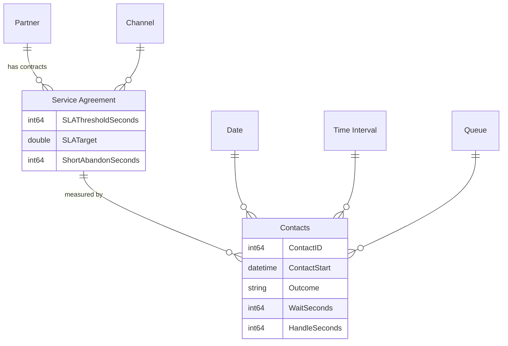

# Contact Center SLA — Power BI

[](https://github.com/vitorchavernue/contact-center-sla-powerbi/actions/workflows/ci.yml)

Service level (SLA) monitoring for a bank's outsourced customer service: **six BPO partners**, **voice and
WhatsApp**, each partner measured against **its own contract** (wait limit, target and short-abandon limit).
Built as an enterprise Power BI project:

- **PBIP / TMDL in Git**: semantic model and report pages are plain text, reviewed like code
- **Star schema** with a contract dimension, so one measure applies **different SLA thresholds per partner and channel**
- **Calculation group** for time intelligence (MTD, YTD, previous year, YoY) instead of copies of every measure
- **Dynamic row-level security**: each partner manager sees only their partner (`USERPRINCIPALNAME()`)
- **Incremental refresh**: rolling 24 months, only the last 3 days refreshed, monthly Parquet files pruned by the query
- **Report as code**: pages, visuals and page designs generated from one layout spec
- **CI quality gate**: the model is loaded with Microsoft's **Tabular Object Model** and checked against
  **19 best-practice rules**, and every field used by the report must exist in the model

> Data is synthetic (fictitious partners), generated with realistic contact center behaviour: intraday peaks,
> waits that grow with load, customers who give up, WhatsApp growing every month.



---

## What the data shows (24 months, 1.51 million contacts)

| KPI | Value |
|---|---:|
| Service level (answered within the contract limit) | **89.2%** vs a volume-weighted target of 83.4% |
| Abandon rate (excluding short abandons) | 4.3% |
| Average speed of answer | 27 s |
| Average handle time | 7 min 22 s |
| Volume growth, last 12 months vs previous 12 | +13.4% · WhatsApp share 27% → 49% |

The average hides three problems the report is built to expose:

1. **Delta CX voice lost its contract in March 2026.** Service level fell from ~86% to ~73% against an 80%
   target and stayed there for seven months: a capacity problem, not a bad week.
2. **Fenix Relacionamento WhatsApp misses its contract while looking good**: 88.0% is a strong number, but the
   contract asks for 90%. Thresholds differ by partner, so a single company-wide target would hide it.
3. **The 10:00–10:30 peak** runs at **75%** service level when the day averages 89%. Monthly averages pass while
   customers wait at the busiest time: the `Intervals Meeting SLA %` measure and the Intraday page show it.

---

## Report pages

| Page | Answers |
|---|---|
| **Service level overview** | Service level vs target by month, gap to target by partner, volume by channel |
| **Intraday** | Service level and volume by half-hour, intervals furthest below target, share of intervals meeting the target |
| **Partner scorecard** | Each contract (partner × channel) with service level, gap, status, abandon, ASA and AHT — the monthly SLA review |
| **Trends and YoY** | 2026 YTD vs the same months of 2025 (service level −0.8 pp, volume +13.1%), this year vs previous year, monthly matrix by calculation item |







## Semantic model



| Design choice | Why |
|---|---|
| Contract dimension (`Service Agreement`) between partner/channel and contacts | The SLA threshold, target and short-abandon limit belong to the contract, not to the contact. Measures evaluate contract by contract (`SUMX`), so mixed selections stay correct |
| Single-direction relationships only | Predictable filters and RLS: the partner filter flows Partner → contract → contacts |
| `Date` marked as date table, `Time Interval` as its own dimension | Contact centers plan and are measured by half-hour |
| Calculation group `Time Intelligence` | `Current`, `MTD`, `YTD`, `PY`, `YoY Δ`, `YoY %` for every measure, with its own format for `YoY %` |
| Implicit measures disabled, keys hidden, every measure documented | Report authors only see curated, documented measures |

Full definitions: [measure dictionary](docs/measures.md).

---

## Quality gate (CI)

[`scripts/validate_model.py`](scripts/validate_model.py) runs on every push:

```
Semantic model loaded: 9 tables, 16 measures, 6 relationships, 2 roles

PASS  Every measure has a description
PASS  Every numeric measure has a format string
PASS  Every measure is in a display folder
PASS  Every visible table has a description
PASS  Implicit measures are disabled (only curated measures)
PASS  Key and id columns are hidden
PASS  Visible numeric columns do not sum by default
PASS  No bidirectional relationships
PASS  Relationships use whole-number or date keys
PASS  One table is marked as the date table
PASS  Text columns with a natural order have a sort column
PASS  Measures divide with DIVIDE (no division by zero errors)
PASS  DAX variables do not use reserved words
PASS  The fact table has an incremental refresh policy using RangeStart/RangeEnd
PASS  Row-level security: at least one role filters by the signed-in user
PASS  Time intelligence comes from a calculation group
PASS  Every field used by the 51 visuals exists in the model
PASS  Every navigation button points to an existing page
PASS  Every page background image is in the project

19/19 rules passed
```

Tests also prove the gate catches mistakes (a measure without description, a `/` division, a visual using a
deleted measure) and that the data has the stories above.

---

## Run it

```bash
make setup      # Python dependencies (+ the TOM assemblies for the quality gate)
make data       # synthetic contacts -> data/ (24 monthly Parquet files)
make kpis       # reference numbers computed in pandas, to check against Power BI
make validate   # quality gate
make test
```

Open `powerbi/ContactCenterSLA.pbip` in Power BI Desktop and set the **DataFolder** parameter to the full path
of the `data` folder (ending with `\`). `RangeStart`/`RangeEnd` load the whole period in Desktop; in the
service, the refresh policy manages the partitions.

## Project structure

```
powerbi/
├── ContactCenterSLA.pbip
├── ContactCenterSLA.SemanticModel/definition/   # TMDL: tables, measures, roles, relationships, refresh policy
├── ContactCenterSLA.Report/                     # PBIR pages and visuals (generated by scripts/build_report.py)
└── design/                                      # page designs (SVG)
scripts/
├── generate_data.py     # synthetic contact center data
├── kpis.py              # reference implementation of the main measures
├── build_report.py      # report as code: pages, visuals and backgrounds
└── validate_model.py    # quality gate
tests/
docs/measures.md
```

## Stack

**Power BI** (PBIP, TMDL, PBIR) · **DAX** · **Power Query (M)** · calculation groups · row-level security ·
incremental refresh · **Tabular Object Model** · **Python** (pandas, NumPy) · **GitHub Actions**
